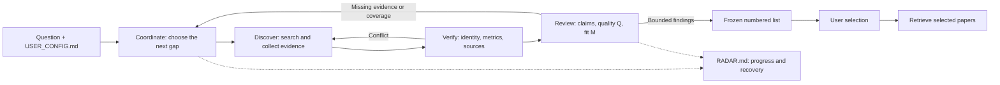

# Paper-Radar

**Start with a research question. Discover, verify, review, and follow the evidence.**

[简体中文](README.md) · **English**

Paper-Radar is a literature research skill executed directly by **Claude Code,
Codex, and other Agent Skills harnesses**. Provide your question, access settings,
and budget. The agent searches complementary sources, checks paper and journal
identity, reads actual evidence, assesses quality and fit, and follows up on gaps.
One RADAR.md preserves progress, decisions, disagreements, and the recovery point.

**[Codex workspace](https://github.com/Haichuan-Zhao/Paper-Radar/raw/refs/heads/main/packages/Paper-Radar-Codex.zip)**
· **[Claude Code workspace](https://github.com/Haichuan-Zhao/Paper-Radar/raw/refs/heads/main/packages/Paper-Radar-Claude-Code.zip)**
· [Portable skill](https://github.com/Haichuan-Zhao/Paper-Radar/raw/refs/heads/main/packages/paper-radar.zip)
· MIT

## The literature loop



Discovery, factual verification, and scientific assessment have distinct handoffs.
Use real native subagents when available and authorized; otherwise run sequentially
and label self_check. Role names and separate contexts do not establish hard
isolation or scientific correctness.

## Quick start

1. Download the workspace for your harness, extract it with hidden directories,
   and open its **Paper-Radar root**. The Codex package contains .agents/skills
   and .codex/agents; Claude Code contains .claude/skills and .claude/agents.
2. Edit **USER_CONFIG.md**: your question, dates, requirements, reading intent,
   own EasyScholar key/secret reference, institutional entry points, and budget.
   You can supply the current question in chat instead.
3. Invoke $paper-radar in Codex or /paper-radar in Claude Code:

```text
Use paper-radar with USER_CONFIG.md in this workspace.
Search deeply for my research question, verify paper and journal identity,
review actual full-text evidence for quality and fit, and follow up on gaps.
If supported, I authorize native subagent collaboration within this task and budget.
Keep actual progress in RADAR.md. Deliver a frozen numbered list first,
then wait for my selection before downloading.
```

The agent checks relevant missing settings before searching and lets you choose
completion or named limitations. Installation/configuration alone does not launch
a search. **Research use needs no Python, Node, project command, or new model API.**

For an existing project, copy the complete [paper-radar/](paper-radar/) folder to
your harness's skill location and optionally copy the [native role templates](adapters/).
Other hosts use the portable bundle. See [harness guidance](paper-radar/references/harness.md)
and current [Codex](https://learn.chatgpt.com/docs/build-skills) /
[Claude Code](https://code.claude.com/docs/en/skills) documentation.

## One editable configuration

The public [USER_CONFIG.example.md](paper-radar/USER_CONFIG.example.md) contains no
personal values. On first use in an existing workspace the agent copies it to
USER_CONFIG.md without overwriting an existing file. An explicitly supplied path
takes precedence; current chat requirements override saved task preferences.
The agent derives scholarly query families itself.

| Section | Purpose |
|---|---|
| Question, dates, constraints, reading intent | Preserve the original request and evaluate real fit |
| EasyScholar key/secret, local metric tables | Use your own ratings with identity, source, edition and data year |
| School, library/SSO URLs, domains, account/session | Check actual login routes and article entitlement |
| Preprints, language, budget, scoring, directories | Control the scope and delivery |

Defaults are a reading target of ten and six substantive rounds. Each round can
include multiple queries, pages, evidence collection and a review batch; these
are not retrieval caps. Unfinished coverage at the budget limit is a partial
delivery. Change the budget in the document or chat.

Inline keys and passwords are plaintext and may be visible to the reading
host/model. Prefer secret references or human browser login; school passwords
need not appear in the file. Filled configurations are ignored by Git and are
not copied into reports or all subagent prompts. EasyScholar supplies ratings,
not subscription access; a saved account does not establish entitlement.

## Quality, fit, and bounded conclusions

| Measure | Default dimensions |
|---|---|
| Q, 0–100 | Motivation 15%, originality 15%, rigor 25%, evidence 25%, reproducibility 10%, figures/argument clarity 10% |
| M, 0–100 | Problem 45%, approach utility 25%, context 20%, reading intent 10% |
| S | Q^0.6 × M^0.4; default Q/M≥70 and rigor/evidence≥3/5, plus evidence and hard-constraint gates |

Review central claims, actual support, conditions and counterevidence. Verify
major criticism too. Prestige, IF, attractive figures and access difficulty add
no Q/M points. Preprints are not penalized for inapplicable journal ratings;
publication status and explicit venue/peer-review requirements remain visible.

Missing full text, relevant figures, closest prior-work comparison, or unresolved
central claims leave final Q/S pending. Qualified findings get narrower wording
and score limits. Confirmed core evidence failures override the composite score.
Journal checks preserve DOI/ISSN, edition, category and year; IF does not prove
WoS inclusion. See [search and verification](paper-radar/references/search.md) and
[review protocol](paper-radar/references/review.md).

The rubric assists reading decisions and has no validated field-wide accuracy or
recall benchmark. Author reports, reviewer judgments, factual checks, and review
independence are separate observations.

## Two stages, pause, and recovery

Stage one delivers reviewed recommendations, pending access/review, exclusions
and actual search coverage, with fixed numbers bound to versions. Lawful reading
and temporary caches are allowed during assessment; archival downloads wait for
your choice. Ask for papers 1 and 3 from that catalog. Version substitution needs
a choice; SI, library writes and notifications require a separate request.

- **Inspect:** read the current understanding, gaps, disagreements and next step at the top of RADAR.md.
- **Pause:** ask to save actual evidence, budget and the recovery point.
- **Resume:** specify RADAR.md and ask the agent to verify artifacts and remaining budget before continuing.
- **Retrieve:** select numbers from a named catalog revision; reordering never changes old numbers.

Tools and institutional access vary by host. Missing capabilities are disclosed;
logins, downloads, figure inspection and independent review are only reported
when actually performed. [Loop protocol](paper-radar/references/loop.md) ·
[Access and retrieval](paper-radar/references/access.md)

## Project and validation

The operating approach draws on [Auto-Loop](https://github.com/Haichuan-Zhao/Auto-Loop):
task-driven work, separated responsibilities, frozen evidence, review feedback,
and recoverable progress. Paper-Radar applies those mechanisms to literature.

The repository includes reviewable source and deterministic installation archives.
Maintainers use Node.js 20+ standard libraries; these scripts are excluded from
installed skills and research workflows:

```bash
node --test tests/package.test.mjs
node scripts/check-skill.mjs
node scripts/package-skill.mjs --check
```

[Acceptance scenarios](tests/acceptance.md) and [offline materials](tests/fixtures/casepack.md)
target decisions; packaging tests do not establish scientific accuracy.
Native role discovery, live EasyScholar keys, school entitlements and every target
platform have not all been tested.

This continues ResearchRadar in the same repository under the paper-radar skill
name. Replace the old skill directory as appropriate; keep personal settings,
papers and historical assessments.

[MIT License](LICENSE)
