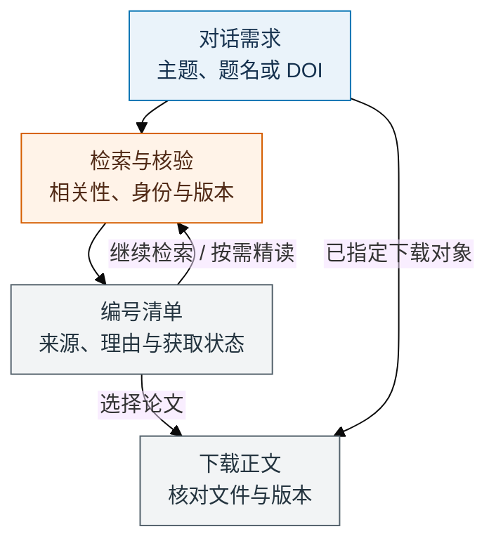

# Paper-Radar：对话式文献检索与下载

当前源码版本 0.5.0 · 中文技能 · [MIT 许可证](LICENSE)

[快速开始](#快速开始) · [使用流程](#使用流程) · [安装技能](#安装技能) · [对话示例](#在对话中使用) · [更新与回退](#更新与回退) · [问题反馈](#问题反馈)

Paper-Radar 是一份中文文献检索与下载技能。说出想找的主题、问题或关键词，智能体按需求检索、去重、核对论文身份与版本，给出编号清单；回复“下载第 1、3 篇”即可继续处理。已经知道要哪篇时，直接给 DOI、题名或链接并要求下载。正文能否取得，取决于可用工具、来源和实际访问权限。

项目借鉴 [Auto-Loop](https://github.com/Haichuan-Zhao/Auto-Loop) 的自包含技能、证据驱动和真实记录思路，按文献检索与下载的用途组织使用方式。想法和条件直接在对话里传递，无需准备需求文档或先建立课题。需要比较方法、评价质量或核查结论时，再开展相应的全文阅读与证据评审。

## 快速开始

1. **安装一次技能。** 将本仓库地址交给 Codex，安装 `.agents/skills/paper-radar`。
2. **直接说需求。** 例如：`使用 $paper-radar，找近三年关于多模态模型幻觉检测的论文，先给我清单。`
3. **选择下载或继续筛选。** 回复 `下载第 1、3 篇`，或继续说 `只保留有公开代码的工作，再找一些。`

一个主题或论文标识就能开始。不必克隆整个仓库，不要求填写模板、配置角色或提供篇数和预算；已有材料、偏好和任务记录可继续使用。

## 使用流程

普通检索先给清单，选定后处理下载；指定论文可直接进入身份、版本与获取核验。后续条件和比较要求仍在同一对话中补充。



初筛会说明判断来自题名、摘要还是全文。期刊评级、深入比较和科学评审按需求使用；未知条件保留待核验，缺全文不编造质量评分。检索过程中遇到身份冲突、遗漏或证据疑点，会回到相应来源补查。

## 安装技能

需要能加载本地技能并访问文献来源的智能体环境；下载还需要文件保存能力。下文以 Codex 为例；其他支持 Agent Skills 的宿主可尝试加载同一份目录，工具能力与兼容性需在实际环境中验证。技能本身不要求单独配置模型 API，模型与工具由宿主提供；Node.js 仅用于本仓库的维护脚本。

### 从 GitHub 安装

将以下内容交给 Codex：

```text
使用 $skill-installer 安装这个 GitHub 仓库中的 paper-radar。
仓库：https://github.com/Haichuan-Zhao/Paper-Radar
技能目录：.agents/skills/paper-radar
安装到当前 Codex 可发现的用户级技能目录，供不同对话使用。
核对实际默认分支；我指定标签、分支或提交时采用指定版本。
已有同名技能时检查原来源和本地定制，按原安装方式处理。
完成后报告实际路径、metadata.version 和来源。本次只安装，不启动检索。
```

只安装完整技能目录，包含以下三个文件；根 README、AGENTS、可选角色和维护工具均不作为安装依赖：

```text
用户级技能目录/
└── paper-radar/
    ├── SKILL.md
    ├── agents/
    │   └── openai.yaml
    └── LICENSE
```

当前 Codex 官方列出的用户级位置为 `~/.agents/skills/`，项目级位置为 `.agents/skills/`。安装器或原管理工具采用其他受支持位置时，以实际加载的入口为准，避免重复安装同名副本。安装和刷新行为见 [OpenAI 官方技能文档](https://learn.chatgpt.com/docs/build-skills)。

### 下载或手动复制

可下载源码 ZIP 或克隆仓库，再复制 `.agents/skills/paper-radar` 完整目录；`.agents` 是隐藏目录，需要开启隐藏文件显示。源码 main 与具体提交是开发来源，版本号本身不证明已有同名发布。

如 [Releases 页面](https://github.com/Haichuan-Zhao/Paper-Radar/releases) 的目标 tag 已提供 `paper-radar.zip` 和 `manifest.json`，可使用同一发布下的这两项资产安装。核对仓库、版本、ZIP SHA-256 与逐文件清单后解压，顶层为 `paper-radar/`。没有对应资产时使用明确的源码版本，不能将旧包当作新版。只解压普通文件，拒绝路径穿越、重复条目、符号链接和清单之外的内容。

已由 Skills Manager 管理时，提供目标分支或 tag 下技能目录的 GitHub URL，沿用原来源、技能标识和部署关系；不要用另一安装器覆盖。下载、克隆和更新源码都不自动刷新已有用户级安装。

### 确认实际入口

```text
请检查 paper-radar 是否可用，报告实际 SKILL.md 路径、metadata.version 和安装来源。
本次只检查，不启动文献研究。
```

按 [OpenAI 官方说明](https://learn.chatgpt.com/docs/build-skills)，Codex 会自动发现新安装的技能；未出现时可尝试重启。有多个同名入口时，先核对本次实际加载的是哪一份。

## 在对话中使用

检索文献：

```text
使用 $paper-radar，帮我找关于大语言模型长上下文评测的论文。
优先关注真实任务中的表现，接受预印本，先给我相关论文清单。
```

清单交付后，直接选择或补充条件：

```text
下载第 1、3 篇的正文。
剩下的只保留有公开代码的工作，再查一下是否遗漏了相关论文。
```

编号绑定论文身份与具体版本，展示子集或重排也不变，不用记运行 ID 或目录修订。明确选中的论文会直接处理；原版本不可得而需改用作者稿或预印本时，先说明差异再让你选择。默认只下载正文，SI、文献库导入和通知按你的另行请求执行。

已有 DOI、链接或准确题名时，可以直接提出下载请求：

```text
使用 $paper-radar，下载下面这篇论文的正文，保存到当前目录的 downloads/。
<粘贴 DOI、论文链接或准确题名>
```

不必先生成检索清单或质量报告。未指定保存路径时，采用当前任务可写目录下的 `downloads/`；成功保存后给出实际文件链接和核验结果。遇到题名歧义、版本差异或访问受限时说明具体问题；没有文件保存能力时提供可访问的来源链接并说明尚未保存。

查询式、来源组合和阅读顺序可以交给智能体。需要时再补充年份、研究对象、期刊条件、篇数或时间上限；未指定日期时，按问题确定检索范围。条件通过对话修改即可，仍有效的检索和证据会被复用，已有上限不会自动重置。

如已有 `USER_CONFIG.md`，可沿用其中的个人服务引用和偏好，无需专门创建。密钥、账号和论文放在共享技能之外的私密位置。EasyScholar 可用于查询期刊评级，具体数据需核对来源与版次；它不授予全文访问权限。机构会话仍需逐篇核对权限，缺少可选服务时先做不受影响的工作。

## 按需深入评价

需要方法比较、质量判断或结论核查时，直接在对话中提出，例如“比较第 2、4 篇的实验设计和适用条件”。普通检索与指定论文下载不以完整评审为前提。

先核对原文与证据，再给阅读排序。核心主张需要不同位置的结果、图表或证明支持；重大批评也需核查正文、附录及更正，不能将未找到材料说成作者没做。

Q 用于整理对内容质量的判断，M 用于整理与当前有效需求的匹配判断，默认综合分为 `S = Q^0.60 × M^0.40`。Q 涉及问题动机、原创性、严谨性、证据、可复核性与图表/公式表达；M 对应对象任务、方法可用性、应用条件与阅读目的。期刊 IF、作者名望和引用数不加内容分。

缺全文或关键依据时最终 Q/S 待评；核心结论未决、严格条件未知或硬约束失败，不能靠高综合分获得推荐。只在收窄条件后成立的结论明确边界，推荐至多为候选阅读项（shortlist）。完整量表、证据上限和门槛自包含于 [SKILL.md](.agents/skills/paper-radar/SKILL.md)。这是本项目用于辅助阅读决策的工作量表，分数与阈值不代表学界统一标准，也不能替代领域专家判断。

复杂任务可在有原生能力且获得授权时使用多智能体。可选的 [Guide](.codex/agents/Guide.toml)、[Scout](.codex/agents/Scout.toml)、[Reviewer](.codex/agents/Reviewer.toml) 是职责配置示例，不固定模型，也不必安装或复制。单智能体评审标明自查；只有未参与被审版本、实际检查原始材料的审查才称为独立审查。[官方子智能体文档](https://learn.chatgpt.com/docs/agent-configuration/subagents#custom-agents) 说明实际配置方式。

## 按需保存记录

简单查询与单篇下载直接在对话中交付。跨回合检索、批量下载或深入评审需要续接时，智能体按需维护少量记录，无需你先准备文件：

| 记录 | 用途 |
| --- | --- |
| selection-catalog.json | 有文件能力时保存供选择的编号清单，固定身份与版本；直接指定的单篇下载无需此文件。 |
| RADAR.md | 需要续接时保存检索条件、真实查询、缺口、已接受限制与恢复位置。 |
| 候选与逐篇证据 | 深入评审时保存可回查证据；少量合入 RADAR，量大才拆分。 |
| downloads/manifest.md | 批量或需续接的下载结果，逐篇记录版本、路径、核验及失败原因。 |
| README.md | 只在需要长期阅读入口时建立，不改写已有项目介绍。 |

记录使用当前任务目录或其中的 `paper-radar-results/<run-id>/`，不同任务分别保存，不写入共享技能目录。不按角色、轮次或检查创建重复报告。旧版布局、`reading-list.md` 和既有候选文件原位续用，不强制迁移。任务中断会交代实际完成情况，不声称后台仍在运行；明确时限到达后只整理状态，继续工作需要新的运行授权。

## 更新与回退

只在明确要求时更新，先确认实际技能路径、来源、版本及本地定制。新版以 SKILL.md 的 `metadata.version` 为版本来源；旧安装中的 `VERSION` 可用于识别历史状态，不再与新字段并行维护。

1. 取得目标分支、tag 或提交的完整技能；正式包核对 ZIP 和逐文件哈希。与旧版本基线比较，无法确认基线时标明未知，先保留定制与额外文件。
2. 按原安装方式更新这一项。在技能扫描目录之外保存备份，处理本地冲突后整体替换确认过的技能，移除已知旧版自有 references/VERSION 等文件；未知或定制内容不能强行清除。写入失败从备份恢复。
3. 复核实际加载路径、metadata.version 与来源；管理器部署沿用原关系，克隆用户仅做 `git pull --ff-only` 不会同步已复制安装，源码 ZIP 也不能直接 pull。

更新仅替换技能，保留已有材料、USER_CONFIG、凭据、RADAR、固定目录、论文与下载记录；有个人文件误放安装目录时先安全迁出并核对，不覆盖未知字段或回显真实值。旧角色文件只在确认属于旧版且无定制时整理。

运行或固定审查中采用的版本保持稳定，在阶段边界更新。既有 `paper-radar-v2` 清单协议和 `paper-content-v2` 量表记录继续保留，不因技能更新而自动重评旧论文、重写编号或清零预算。已有轮次、日期或篇数限制仍然有效。回退使用备份或先前明确版本，保留当前课题数据并说明兼容性核对结果与未验证项。

## 问题反馈

遇到安装、检索、编号、版本或下载问题，可在 [GitHub Issues](https://github.com/Haichuan-Zhao/Paper-Radar/issues) 反馈。建议附上：

- 实际技能版本、安装方式、宿主名称与版本。
- 可复现的请求、预期行为和实际结果；涉及论文时附公开 DOI 或链接。
- 脱敏后的错误信息和最少必要记录。

提交前移除密钥、账号、会话令牌和个人路径；非公开论文或数据请仅描述问题，不上传原件。检索遗漏或判断错误也可反馈，并尽量提供可回查的来源。

## 仓库维护与验证

| 文件 | 职责 |
| --- | --- |
| [.agents/skills/paper-radar/](.agents/skills/paper-radar/) | 唯一、自包含的中文技能，三个公开文件。 |
| [.codex/agents/](.codex/agents/) | 可选职责配置，供需要自定义角色时参考。 |
| [AGENTS.md](AGENTS.md) | 仓库维护约定，不是课题依赖。 |
| [scripts/](scripts/) 与 [tests/](tests/) | 维护者检查与分发工具，不是文献研究运行时。 |

维护工具使用 Node.js 20+ 标准库：

```sh
node scripts/check-skill.mjs
node --test tests/package.test.mjs
node scripts/package-skill.mjs
```

打包生成 `dist/paper-radar.zip` 和 `dist/manifest.json`，不把安装包或临时验证产物提交到源码。现有工作流在 main 分支手动触发且检查通过后，才尝试创建 `v<metadata.version>` 发布并上传两项资产；发布是否成功以 GitHub 实际结果为准。版本更新和本地打包本身不等于已发布。

[行为验收](tests/acceptance.md) 和 [合成材料](tests/fixtures/casepack.md) 区分结构测试、离线自查、独立评审及真实线上验证。格式或分发通过不证明科学准确率；真实 key、机构订阅、各宿主发现和在线检索仍按实际访问验证。

本项目采用 [MIT 许可证](LICENSE)。技能与说明维护中文版本，许可证保留标准原文；实际论文、数据及第三方材料遵守各自许可和访问条件。
