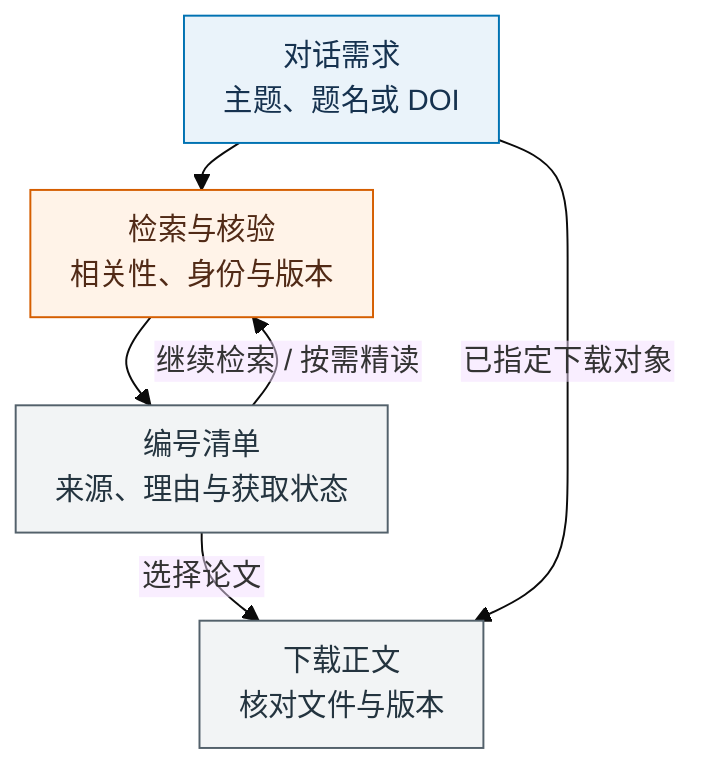

# Paper-Radar：对话式文献检索与下载

中文技能 · [MIT 许可证](LICENSE)

[安装](#安装) · [使用流程](#使用流程) · [对话示例](#在对话中使用) · [个人配置](#可选个人配置) · [更新](#更新与记录) · [反馈](#问题反馈)

说出想找的主题，Paper-Radar 检索、去重并核对论文身份与版本，给出编号清单；回复“下载第 1、3 篇”即可继续。已有 DOI、题名或链接时，直接要求下载正文。

需求和筛选条件在对话里传递。个人配置只保存可复用的服务 key、图书馆信息和保存偏好，按需使用。技能调用宿主实际提供的工具，全文获取取决于来源和访问权限。

## 安装

将以下内容交给 Codex：

```text
使用 $skill-installer 安装 https://github.com/Haichuan-Zhao/Paper-Radar
中的 .agents/skills/paper-radar 技能。
已有安装时先核对来源与本地定制，沿用原管理方式；只安装，不启动检索。
完成后报告实际加载路径和来源；能核实时附 Git 提交。
```

用户只需安装 `.agents/skills/paper-radar/` 中的三份文件，安装后的目录为：

```text
paper-radar/
├── SKILL.md
├── agents/
│   └── openai.yaml
└── LICENSE
```

也可手动复制这个目录到宿主可发现的技能位置。搜索、浏览器和文件工具由宿主提供，无需另外下载运行程序。个人 `USER_CONFIG.md` 在本地按需创建，不随技能分发。

默认安装仓库 `main` 分支中的技能目录，需要固定内容时指定 Git 提交。多个同名安装先核对实际入口，管理器安装沿用原部署关系。

## 使用流程



普通检索先给清单，明确选定后处理下载；指定论文可直接进入身份、版本和获取核验。初筛注明依据来自题名、摘要还是全文，不默认逐篇做完整质量评审。

## 在对话中使用

检索文献：

```text
使用 $paper-radar，找近三年关于大语言模型长上下文评测的论文。
关注真实任务中的表现，接受预印本，先给清单。
```

随后直接说 `下载第 1、3 篇`，或 `只保留有公开代码的工作，再找一些`。编号绑定论文及具体版本，筛选、重排也不变，不用记内部运行 ID。

指定论文下载：

```text
使用 $paper-radar，下载下面这篇论文的正文。
<粘贴 DOI、论文链接或准确题名>
```

未指定路径时使用当前任务目录下的 `downloads/`，个人配置可设默认目录；成功后返回实际文件链接和核验结果。缺少访问或保存能力时说明具体缺口，不声称已下载。原版本不可得而需要换用其他稿件时先说明差异；默认只要正文，SI、文献库导入和通知按另行请求处理。

主题或论文标识就能开始，不要求需求文档、篇数、预算或配置。日期、期刊条件和阅读目的都可在对话中补充；修改条件时复用有效结果，既有上限不重置。

## 可选个人配置

需要时直接让智能体创建 `USER_CONFIG.md`，填需要的项，其余留空：

- **服务**：EasyScholar key，以及其他服务的名称、官方 API 入口和 key。
- **图书馆**：机构、官网、校外访问入口、允许域名、登录方式与订阅线索。
- **保存偏好**：正文下载目录。

配置按以下顺序使用，采用首个存在的文件，不合并多份凭据：

1. 本次对话明确指定的配置路径。
2. 当前任务工作目录中的 `USER_CONFIG.md`。
3. `~/.config/paper-radar/USER_CONFIG.md`，适合本人在不同任务中复用。

例如说 `使用 $paper-radar，后续用这个配置文件：<实际路径>`。显式指定的文件不存在时会说明，不静默换用其他身份；没有配置仍可检索和获取可用的 OA 正文。只安装技能时，也可直接请智能体创建一份空白配置，无需复制仓库。

key 可直接填写，也可用 `env: 环境变量名` 或 `file: 私密凭据文件路径`。实际配置及备份由本仓库 Git 忽略，不随技能分发。明文可能被宿主和模型读取，配置中不要保存密码、Cookie 或会话令牌。技能不回显真实 key，缺私密调用能力时跳过受影响服务。

优先复用已登录的机构会话，登录和验证码在真实页面由你完成。图书馆和订阅说明只是线索，单篇全文权限仍要核验；EasyScholar 的评级不能授予全文权限。相对凭据路径以配置目录为准，相对下载目录以当前任务目录为准。

## 按需深入评价

直接提出“比较第 2、4 篇的实验设计和适用条件”，即可围绕问题阅读全文、图表及必要前作。核心主张与重大批评都需要可回查证据，缺材料保持待评，IF 和作者名望不加内容分。

Q、M 与综合分用于辅助阅读决策，证据门槛和硬条件先于排序；工作量表与完整规则在 [SKILL.md](.agents/skills/paper-radar/SKILL.md)，不代表通用科学认证。普通检索和已选论文下载不以这些评分为前提。

复杂任务可在原生能力与人类授权允许时分工，不需要额外角色文件。独立审查须由未参与被审版本的审查者直接核对原始材料；单智能体只能标为自查。

## 更新与记录

简单任务直接在对话交付。供后续选择的清单固定编号；有文件能力时保存 `selection-catalog.json`，需要续接时再建立一份 `RADAR.md`，批量下载按需保存 `downloads/manifest.md`。已有记录原位续用，不改写现有项目 README，也不按角色和轮次重复建报告。

只在明确要求时更新技能：核对实际来源和定制，在扫描目录外备份，按原方式替换完整技能并复核。个人配置、论文、固定编号与历史记录保持原位。运行中的固定规则在阶段边界更新，不自动重评、延长上限或迁移任务数据。源码更新不等于已刷新复制安装。

## 问题反馈

在 [GitHub Issues](https://github.com/Haichuan-Zhao/Paper-Radar/issues) 提供技能来源、可核实的 Git 提交、安装方式、宿主、可复现请求和脱敏错误；论文问题附公开 DOI 或链接。不要上传真实配置、账号、会话或非公开论文。

项目借鉴 [Auto-Loop](https://github.com/Haichuan-Zhao/Auto-Loop) 的自包含技能与证据驱动思路，保留对话检索和下载的使用方式。代码和说明采用 [MIT](LICENSE)，论文及第三方材料遵守各自许可。
