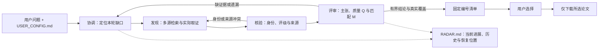

# Paper-Radar

**从一个研究问题开始，循环发现、核验与评审，找到值得读的论文。**

**简体中文** · [English](README.en.md)

Paper-Radar 是由 **Claude Code、Codex 等 harness 直接执行**的文献研究 skill。
你提供问题、个人访问配置和预算，agent 多源搜集文献，核对论文与期刊信息，
阅读真实证据并评价内容质量与需求匹配度，再针对缺口继续补查。
进展保存在一份 RADAR.md，支持暂停、恢复和追溯。

**[Codex 完整包](https://github.com/Haichuan-Zhao/Paper-Radar/raw/refs/heads/main/packages/Paper-Radar-Codex.zip)**
· **[Claude Code 完整包](https://github.com/Haichuan-Zhao/Paper-Radar/raw/refs/heads/main/packages/Paper-Radar-Claude-Code.zip)**
· [通用 skill 包](https://github.com/Haichuan-Zhao/Paper-Radar/raw/refs/heads/main/packages/paper-radar.zip)
· MIT

## 文献循环



发现方交付材料，核验方检查事实，评审方判断证据能支持什么。
有真实子 agent 且获授权时分工；否则顺序执行并标注 self_check。
角色名称、独立上下文和高分都不等于科学认证。

## 快速开始

1. 下载对应宿主的完整包，解压并保留隐藏目录，在 **Paper-Radar 根目录**打开。
   Codex 包带 .agents/skills 与 .codex/agents；Claude Code 包带 .claude/skills 与 .claude/agents。
2. 编辑 **USER_CONFIG.md**。它是普通 Markdown 表格，可填 EasyScholar key/私密引用、
   学校邮箱与真实图书馆/SSO 入口、研究问题、日期、偏好和预算。也可在聊天中给本次问题。
3. 发送启动指令。Codex 可用 $paper-radar，Claude Code 可用 /paper-radar：

```text
使用 paper-radar，读取当前工作区的 USER_CONFIG.md。
请围绕我提出的问题深入搜集论文，核对身份和期刊评级，
基于实际全文证据评审质量与匹配度，发现缺口后继续补查。
若宿主支持，我授权在本任务范围与预算内使用原生子 agent 分工。
将实际进展保存在 RADAR.md，先给固定编号结果，等我选择后再下载。
```

首次未配置时 agent 先检查并给出缺项影响，由你决定补全或本次接受限制。
只请求安装/配置时不启动文献任务。**研究使用不需要 Python、Node、项目运行命令或新模型 API。**

已有项目可复制完整 [paper-radar/](paper-radar/) 到宿主 skill 目录，再按需复制
[原生角色模板](adapters/)；其他支持 Agent Skills 的宿主使用通用包。
安装位置与能力差异见 [宿主说明](paper-radar/references/harness.md)，
以 [Codex](https://learn.chatgpt.com/docs/build-skills) 与
[Claude Code](https://code.claude.com/docs/en/skills) 的实际版本文档为准。

## 用户只维护一份配置

公开的 [USER_CONFIG.example.md](paper-radar/USER_CONFIG.example.md) 不包含个人值。
安装到已有工作区时，agent 首次将它复制为 USER_CONFIG.md；已有文件不覆盖。
显式指定的其他配置路径优先。聊天需求覆盖已保存的任务偏好，agent 自行推导检索式。

| 配置内容 | 用途 |
|---|---|
| 问题、日期、必须条件与阅读目的 | 保留原始需求，评价真实匹配 |
| EasyScholar key/secret、本地评级表 | 使用每位用户自己的期刊数据，保存身份/来源/版次/数据年 |
| 学校、图书馆/SSO、允许域名、邮箱/账号与会话 | 按实际机构访问与单篇权限处理 |
| 预印本、语言、预算、评分与目录 | 调整本次工作范围和交付方式 |

默认精读目标 10 篇、六轮实质性工作；一轮可包含多查询、分页、取证与一批评审，
**不是检索六篇或只查六次**。篇数不限制候选池。预算耗尽仍有未完成分支时保存部分结果，
不伪称穷尽。可在配置或聊天中明确更适合自己的预算。

直接填入的 key/密码是明文，可能被读取文件的宿主/模型看到。
优先 secret 引用或在真实网页登录，学校密码不必写在文档里。
填写后的文件不提交 GitHub，不复制给所有子 agent；仓库已忽略个人配置和研究输出。
EasyScholar 不提供收费论文权限，邮箱密码也不证明有订阅。

## 质量、匹配与证据门槛

内容质量 Q 与原始需求匹配 M 分开评，再综合排序：

| 指标 | 默认维度 |
|---|---|
| Q（0–100） | 动机 15%、创新 15%、严谨性 25%、证据 25%、可复核性 10%、图表/论证表达 10% |
| M（0–100） | 问题 45%、方法可用性 25%、应用条件 20%、阅读目的 10% |
| S | Q^0.6 × M^0.4；默认 Q/M≥70 且严谨性/证据≥3/5，再检查证据与硬约束 |

审查覆盖核心主张、真实支持、适用条件和反证；重大批评本身也要核查。
作者声誉、IF、漂亮配色和获取难易不加减 Q/M。预印本缺期刊评级不扣分，
但发表/同行评审状态会注明，用户明确的限刊/评级条件单独过滤。

缺全文、必要图表、创新比较或核心主张未决时，最终 Q/S 待评。
有限范围支持就收窄结论；经核查的核心证据失败不能用高综合分抵消。
评级关联核对 DOI/ISSN、版次、学科与数据年，IF 不证明 WoS 收录。
详见 [检索核验](paper-radar/references/search.md) 与
[评审评分](paper-radar/references/review.md)。

这些量表用于辅助阅读决策，尚无领域准确率或召回率基准。
论文结论、LLM 判断、事实核验和独立评审的范围会分别呈现。

## 两步交付、暂停与恢复

第一步交付推荐、待评/待获取队列、重要排除与真实检索覆盖，固定编号绑定论文版本。
评价期间允许合法阅读全文和临时缓存；正式批量归档等待你的选择。
之后回复“下载这份清单第 1、3 篇”，agent 只处理该集合。
换版本先让你选择，SI、文献库导入和通知需另行请求。

- **查看**：读取该 run 的 RADAR.md 顶部，了解已知、未知、分歧和下一步。
- **暂停**：“暂停 paper-radar，保存实际证据、预算和恢复位置。”
- **恢复**：“使用 paper-radar 恢复这次任务，读取指定 RADAR.md，核对产物与剩余预算后继续。”
- **下载**：“下载目录修订 1 中的第 1、3 篇。”旧编号不会随重排改变。

原生子 agent、正文/图片、私密请求和机构浏览器能力依宿主而异。
无相关能力时标明限制；登录、下载和独立审查只在实际完成后报告。
[循环协议](paper-radar/references/loop.md) · [全文获取](paper-radar/references/access.md)

## 项目与验证

运行思路借鉴 [Auto-Loop](https://github.com/Haichuan-Zhao/Auto-Loop)：
任务驱动、职责分离、固定证据后审查、用实际发现推动下一轮，并保存可恢复记录。
Paper-Radar 将这些机制用于文献发现与阅读评价。

仓库保留可审查源码，packages 提供确定性构建的安装包。
维护者用 Node.js 20+ 标准库检查结构、公开配置、隔离与打包；脚本不随 skill 分发：

```bash
node --test tests/package.test.mjs
node scripts/check-skill.mjs
node scripts/package-skill.mjs --check
```

[验收场景](tests/acceptance.md) 与 [离线材料](tests/fixtures/casepack.md)
用于检查实际决策；分发测试不证明科学准确性。
完整宿主角色发现、真实 EasyScholar key、学校订阅与跨平台运行尚未全部实测。

原项目 ResearchRadar 在同一仓库延续，新的 skill 名为 paper-radar。
旧安装可换成完整新目录；原个人配置与文献保留，不自动重写历史评审。

[MIT License](LICENSE)
